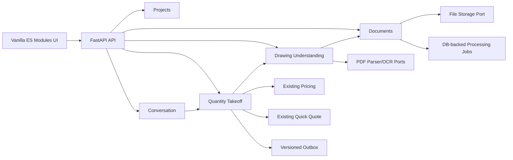

# GÜRSAR AI Proje Okuma ve Metraj Ana Planı

## 1. Hedef

GÜRSAR AI; konuşma sırasında doğru iş kalemini yöneten, PDF proje paftalarını kaynaklarıyla
okuyan, kullanıcı doğrulamalı metraj üreten ve yalnızca sürümlü şirket fiyatlarından hesap yapan
güvenilir bir inşaat asistanına dönüşecektir.

Sistemin ilk üretim hedefi tam otomatik metraj değildir. İlk hedef, her ölçümü pafta, koordinat,
yöntem ve kullanıcı onayıyla kanıtlayan hızlı bir yarı otomatik metraj iş akışıdır. Otomatik model
eğitimi ancak yeterli doğrulanmış veri toplandıktan sonra başlar.

## 2. Değişmez kalite ilkeleri

1. LLM fiyat, miktar, toplam, vergi veya geometrik ölçüm hesaplamaz.
2. Para hesapları `Decimal`, geometri hesapları test edilmiş deterministik servislerle yapılır.
3. Her otomatik sonuç kaynak dosya, dosya sürümü, pafta, koordinat, yöntem ve güven puanı taşır.
4. İnsan tarafından doğrulanan veri, daha düşük güvenli AI çıktısıyla değiştirilemez.
5. Ağ veya Ollama kapalıyken temel proje, ölçüm, fiyat ve hesap defteri işlevleri çalışır.
6. Bir modül başka bir modülün ORM tablosuna doğrudan erişmez.
7. Yeni entegrasyonlar port/adaptör arkasında tutulur ve ağsız sahte adaptörle test edilir.
8. Dosya yükleme güvenli, boyut sınırlı, türü içerikten doğrulanmış ve sürümlü olmalıdır.
9. Silme ve revizyon işlemleri denetlenebilir olmalı; sözleşmesel sonuçlar yeniden üretilebilmelidir.
10. Kullanılmayan özellik bayrağı, adapter, endpoint, fonksiyon veya geçici uyumluluk katmanı bırakılmaz.

## 3. Mimari yaklaşım

Mevcut modüler monolit korunur. Mikroservis, mesaj kuyruğu veya ayrı frontend framework'ü ancak
ölçülmüş bir ihtiyaç ve ADR ile eklenebilir.



### 3.1 Yeni modüller

| Modül | Sorumluluk | Sahip olduğu kayıtlar |
| --- | --- | --- |
| `projects` | Proje yaşam döngüsü ve proje bağlamı | `projects` |
| `documents` | Dosya sürümü, hash, güvenli depolama, pafta ve işlem işi | `documents`, `document_versions`, `sheets`, `processing_jobs` |
| `drawing_understanding` | OCR, antet, ölçek ve tespit sonuçları | `drawing_scales`, `detections`, `extracted_texts` |
| `quantity_takeoff` | Ölçüm geometrisi, miktar, doğrulama ve iş kalemi eşlemesi | `measurements`, `takeoff_items`, `measurement_reviews` |

`pricing`, `quick_quote`, `conversation`, `legal_knowledge`, `service_catalog` ve `work_package`
mevcut sahipliklerini korur. Yeni modüller bu tabloları okumaz; sürümlü uygulama sözleşmeleri
üzerinden işlem yapar.

### 3.2 Temel sözleşmeler

```text
ProjectDocumentV1
  id, project_id, original_name, media_type, sha256, status

SheetV1
  id, document_version_id, page_number, title, discipline, width, height

DrawingScaleV1
  sheet_id, ratio, calibration_points, source, confidence, confirmed_by

MeasurementV1
  id, sheet_id, kind, geometry, unit, value, method, confidence, revision

MeasurementEvidenceV1
  document_version_id, page_number, bounding_box, source_text, extraction_method

TakeoffItemV1
  id, project_id, service_code, measurement_ids, quantity, unit, review_status
```

Durumlar string dağınıklığıyla değil enum/değer nesneleriyle tanımlanmalıdır. API, domain ve ORM
tipleri ayrı kalmalıdır.

## 4. Konuşma durum motoru

LLM veya kural tabanlı anlayıcı yalnızca gerçekleri çıkarır:

```json
{
  "intent": "price_calculation",
  "action": "add",
  "service_code": "formwork.labor",
  "quantity": "2000",
  "unit": "m2",
  "material_included": false,
  "target_item_id": null,
  "confidence": 0.97
}
```

Desteklenen eylemler: `add`, `update`, `remove`, `query`, `total`, `clarify`.

- “Demir kaçtı?” `query` olmalı ve yeni kalem oluşturmamalıdır.
- “Demiri 2500 m² yap” mevcut kalemi `update` etmelidir.
- Sadece “2000” mesajı, yalnızca açık bir bekleyen soruya bağlanmalıdır.
- Yeni bir açık iş türü, eski bekleyen iş türünün bağlamını güvenli şekilde sonlandırmalıdır.
- “Kaba inşaat” malzeme sorumluluğu netleşmeden toplam üretmemelidir.
- Hesap defteri sunucu tarafındaki kalıcı projeksiyondan üretilmeli, frontend tahmini tutulmamalıdır.

## 5. PDF MVP iş akışı

1. Proje oluştur.
2. PDF yükle ve içerik imzasından doğrula.
3. SHA-256 ile aynı dosyayı tekrar işlemeyi önle.
4. Sayfa bilgilerini ve küçük ön izlemeleri üret.
5. PDF.js ile sayfaları ihtiyaç oldukça göster.
6. Vektör metni çıkar; yetersizse OCR işini kuyruğa al.
7. Kullanıcı iki noktayla ölçeği kalibre etsin.
8. Kullanıcı uzunluk, alan veya adet ölçümü oluştursun.
9. Backend ölçümü yeniden hesaplayıp doğrulasın.
10. Ölçümü servis kataloğundaki bir iş kalemine bağla.
11. Onaylanan miktarı fiyat/hesap defteri sözleşmesine gönder.
12. Sonuçta paftaya geri götüren kaynak bağlantısını göster.

İlk sürümde otomatik duvar/kapı/kolon tanıma yoktur. Kullanıcı etiketleri daha sonraki eğitim
verisini oluşturur.

## 6. API taslağı

```text
POST   /api/v1/projects
GET    /api/v1/projects/{project_id}
POST   /api/v1/projects/{project_id}/documents
GET    /api/v1/documents/{document_id}
GET    /api/v1/documents/{document_id}/sheets
GET    /api/v1/sheets/{sheet_id}/render
POST   /api/v1/sheets/{sheet_id}/scale-calibrations
POST   /api/v1/sheets/{sheet_id}/measurements
PATCH  /api/v1/measurements/{measurement_id}
DELETE /api/v1/measurements/{measurement_id}
POST   /api/v1/measurements/{measurement_id}/confirm
POST   /api/v1/projects/{project_id}/takeoff-items
GET    /api/v1/projects/{project_id}/takeoff-summary
```

Yazma endpoint'lerinde idempotency anahtarı veya beklenen revizyon kullanılmalıdır. Eşzamanlı
güncellemeler sessizce veri ezmemeli, `409 Conflict` üretmelidir.

## 7. Dosya güvenliği

- Dosya uzantısına veya istemcinin MIME değerine güvenme; magic byte kontrolü yap.
- İlk sürümde sadece PDF kabul et; şifreli, bozuk veya limit üstü dosyayı reddet.
- Orijinal dosya adı depolama yolu olarak kullanılmasın; rastgele sunucu kimliği kullanılsın.
- Dosya kökü web sunucusundan doğrudan erişilebilir olmasın.
- Path traversal, zip bomb, aşırı sayfa, aşırı çözünürlük ve zaman aşımı testleri yazılsın.
- İşlemciye sayfa, bellek, süre ve eşzamanlılık limitleri konulsun.
- Dosya sürümü değişmez olsun; yeni yükleme yeni sürüm oluştursun.
- Hash, boyut, içerik türü, yükleyen ve zaman damgası denetim kaydına işlensin.

## 8. Performans hedefleri

| İşlem | Hedef |
| --- | --- |
| Sağlık endpoint'i p95 | `< 100 ms` |
| Proje/özet okuma p95 | `< 300 ms` yerel veritabanı |
| Mesaj yanıtı, model hariç p95 | `< 500 ms` |
| Ölçüm oluşturma p95 | `< 250 ms` |
| İlk PDF sayfasını gösterme | `< 2 sn` tipik dosyada |
| Kullanıcı etkileşiminde ana iş parçacığı bloklama | `< 100 ms` dilimler |

PDF sayfaları ve OCR sonuçları hash ile önbelleklenmeli; bütün belge başlangıçta render edilmemelidir.
İşler sınırlandırılmış eşzamanlılıkla çalışmalı ve durumları yeniden başlatma sonrasında devam
edebilmelidir. FastAPI `BackgroundTasks` kalıcı iş garantisi olarak kullanılmamalıdır; MVP için
DB tabanlı iş tablosu ve ayrı worker süreci yeterlidir.

## 9. Test ve kalite kapıları

Her faz aşağıdaki kapılardan geçmeden tamamlanmış sayılmaz:

```powershell
.\.venv\Scripts\python.exe -m ruff check .
.\.venv\Scripts\python.exe -m pyright
.\.venv\Scripts\python.exe -m pytest
```

Ek kapılar:

- Değişen domain/application kodunda yüksek dal kapsamı; kritik hesaplarda yüzde 100 sınır testi.
- API sözleşme testleri ve migration yükseltme testi.
- Dosya ayrıştırıcılar için bozuk/kötü niyetli fixture testleri.
- Fiyat, miktar, ölçek ve birim dönüşümü için property/boundary testleri.
- Frontend ölçüm etkileşimleri için Playwright smoke testleri.
- Ağ kullanan adapter testleri varsayılan test paketinde sahte cevaplarla çalışmalı.
- Sabit zaman ve sabit kimlik sağlayıcılarıyla deterministik test yapılmalı.

Mevcut başlangıç çizgisi: 36 test geçiyor ve Ruff temiz. Pyright sanal ortam paketlerini
çözümleyemediği için kalite kapısı şu anda başarısızdır; yeni özellikten önce bu yapılandırma
düzeltilmelidir.

## 10. Ölü kod politikası

1. Her yeni üretim koduna aynı PR/commit içinde çağıran kod ve test eklenir.
2. “Sonra lazım olur” diye boş adapter, interface veya endpoint yazılmaz.
3. Eski davranış kaldırılırken önce kullanım ve test kapsamı doğrulanır; sonra kod ve test birlikte
   kaldırılır.
4. Geçici uyumluluk koduna sahip, kaldırma şartı ve takip kaydı verilmeden kod birleştirilmez.
5. Python için Ruff ve gerektiğinde Vulture; JavaScript için ESLint `no-unused-vars` çalıştırılır.
6. Kullanılmayan migration geri alınmaz; geçmiş migration değişmez, yeni düzeltme migration'ı yazılır.
7. Public sözleşme olmayan gereksiz soyutlama eklenmez; üç gerçek kullanım oluşmadan generic yapı
   kurulmaz.

## 11. Fazlar ve kabul kriterleri

### Faz 0 — Temel sağlamlaştırma

- Pyright sanal ortam/bağımlılık çözümlemesini düzelt.
- README kodlamasını ve Windows/Linux komutlarını doğrula.
- CI'da Ruff, Pyright ve Pytest çalıştır.
- Mevcut davranış için regresyon testlerini koru.

**Bitiş:** Tüm kalite komutları sıfır çıkış koduyla geçer.

### Faz 1 — Konuşma durum motoru

- Sürümlü eylem sözleşmesi oluştur.
- `add/update/remove/query/total/clarify` ayrımını domain/application katmanında uygula.
- Aynı kalemi tekrar sormanın deftere ekleme yapmadığını doğrula.
- Bekleyen miktarın farklı iş kalemine yanlış bağlanmadığını test et.
- Özet toplamı sunucu tarafında, kalem kalem üret.

**Bitiş:** Bilinen kullanıcı senaryolarının tamamı ağsız regresyon testleriyle geçer.

### Faz 2 — Proje ve güvenli PDF yükleme

- `projects` ve `documents` modülleri, migration ve API.
- Güvenli dosya saklama portu ve yerel adapter.
- Hash, sürüm, limit, hata ve işlem işi kayıtları.
- PDF sayfa listesi ve tembel render.

**Bitiş:** Geçerli PDF yüklenir; bozuk, sahte, şifreli ve limit üstü dosyalar güvenli reddedilir.

### Faz 3 — Ölçek ve manuel metraj

- PDF.js tabanlı viewer ve ayrı ES modülleri.
- Kalibrasyon, uzunluk, alan ve adet araçları.
- Backend geometri doğrulaması ve revision/optimistic concurrency.
- Kaynak kanıtıyla iş kalemine bağlama.

**Bitiş:** Yenileme sonrasında ölçümler korunur ve aynı pafta üzerinde tekrar üretilebilir.

### Faz 4 — Belge çıkarımı ve OCR

- PDF metin çıkarma portu; OCR fallback portu.
- Antet, pafta adı, disiplin, ölçek adayı ve metin koordinatları.
- Güven puanı ve kullanıcı doğrulama akışı.
- Hash tabanlı tekrar kullanım ve ayrı worker.

**Bitiş:** OCR sonucu hiçbir zaman onaysız sözleşmesel miktara dönüşmez.

### Faz 5 — DXF ve IFC

- `ezdxf` adapteriyle DXF katman/eleman analizi.
- `IfcOpenShell` adapteriyle IFC özellik ve QTO çıkarımı.
- That Open Components ile 3B görüntüleme.
- Tüm dış çıktılar ortak `MeasurementV1/EvidenceV1` sözleşmesine dönüşür.

### Faz 6 — Hibrit mevzuat RAG

- Türkçe normalizasyon + lexical + semantic retrieval + reranking.
- Sayfa/madde kaynak zorunluluğu ve yetersiz kaynakta güvenli ret.
- PostgreSQL/pgvector geçişi için ayrı ADR ve ölçümlü migration planı.

### Faz 7 — Eğitim verisi ve otomatik tespit

- Yalnız doğrulanmış kullanıcı düzeltmelerini anonim veri setine aktar.
- Etiket sözlüğü ve veri sürümlemesi oluştur.
- En az 300–500 pafta ve 20–30 proje olmadan özel model eğitme.
- Veri bölmesini pafta bazında değil proje bazında yap.
- İlk hedefler: antet, pafta türü, duvar, kapı, pencere ve mahal.
- Üretim modeli yalnız ölçülmüş doğruluk, geri çağırım ve kalibrasyon eşiğini geçerse açılır.

## 12. İlk uygulanacak iş paketi

İlk uygulama döngüsü yalnız Faz 0 ve Faz 1'i kapsamalıdır. Bunlar tamamlanmadan PDF özelliğine
geçilmemelidir. İkinci döngü Faz 2; üçüncü döngü Faz 3 olmalıdır. Her döngünün sonunda kod, test,
migration, dokümantasyon ve performans kanıtı birlikte teslim edilir.
