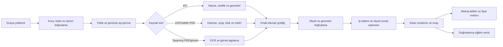

# GÜRSAR AI Sistem Durumu ve Proje Okuma Eğitim Raporu

Tarih: 27 Ağustos 2026  
Kapsam: Yerel kod, yerel veritabanı, kurulu modeller, API sözleşmeleri, otomatik testler ve proje okuma yol haritası

## 1. Yönetici özeti

GÜRSAR AI bugün çalışan bir **inşaat konuşma, teklif, yaklaşık metraj, dosya analizi ve mevzuat destek sistemi**dir. Sistem tek bir özel eğitilmiş yapay zekâ modeli değildir. Beş ayrı bileşenin birleşimidir:

1. Kural tabanlı müşteri niyeti ve konuşma durum motoru,
2. Ollama üzerinde çalışan genel amaçlı `qwen3:8b` yerel konuşma modeli,
3. Şirket fiyat defteri ve deterministik para hesabı,
4. Mevzuat ve şartname arama sistemi,
5. PDF, görsel, DXF ve IFC için açık kaynak belge analiz araçları.

Sistem bugün sohbet içinde işçilik fiyatı sorabilir, kalem ekleyebilir/revize edebilir/silebilir, toplam çıkarabilir, yaklaşık bina metrajı üretebilir, proje dosyalarından metin ve temel envanter çıkarabilir. Ancak henüz bir paftayı insan gibi okuyup duvar, kolon, kiriş, kapı, mahal ve tesisat elemanlarını güvenilir şekilde tanıyarak otomatik metraja dönüştüremez.

En önemli sonuçlar:

- Konuşma ve fiyat çekirdeği çalışıyor ve geniş regresyon testlerine sahip.
- Proje dosyası kabulü ve temel analiz çalışıyor; semantik proje okuma kısmi.
- Yaklaşık metraj motoru var ancak yerel tamamlanmış proje verisiyle eğitilmemiş.
- Mevzuat korpusu var ancak içerik kalitesi ve kapsamı temizlenmeli.
- Yeni hibrit bilgi araması mevcut veri hacminde bellek hatası veriyor; üretim için uygun değil.
- Güvenlikte QR görüşme izolasyonu ve görüşme sahipliği çözülmeden dış erişim açılmamalı.
- Proje okuma için ilk doğru hedef tam otomasyon değil, kaynak gösteren ve kullanıcı onaylı yarı otomatik metraj olmalı.

## 2. Doğrulanmış sistem envanteri

### 2.1 Çalışma ortamı

| Bileşen | Mevcut durum |
| --- | --- |
| Backend | FastAPI, Python 3.12, SQLAlchemy, Alembic |
| Veritabanı | SQLite; geliştirme için uygun, çok kullanıcılı üretim için yetersiz |
| Frontend | Framework bağımsız HTML/CSS/JavaScript |
| Yerel LLM | Ollama `qwen3:8b` çalışıyor |
| Yerel yedek model | Ollama `qwen3:4b` kurulu |
| Uzak LLM adaptörü | Groq/OpenAI uyumlu adaptör kodda var |
| Uzak LLM aktif mi? | Hayır; mevcut çalışmada Groq yapılandırılmamış |
| Müşteri anlayıcı | Kural tabanlı |
| Kalıcı PDF limiti | 50 MB, en fazla 500 sayfa |
| Eşzamanlı PDF analizi | İlk 25 sayfa |
| CI | GitHub Actions: Ruff, Pyright, Pytest |
| Kod kalite sonucu | Ruff temiz; Pyright 0 hata/0 uyarı |
| Test sonucu | 113 test geçti; bir `TestClient/httpx` geçiş uyarısı var |

### 2.2 Veritabanı özeti

| Kayıt | Sayı | Yorum |
| --- | ---: | --- |
| Proje | 4 | Çoğu geliştirme/smoke kaydı |
| Kalıcı proje belgesi | 3 | Tümü PDF |
| Belge sürümü | 3 | SHA-256 ile sürümlü |
| Pafta/sayfa | 13 | Disiplinlerin tamamı `UNKNOWN` |
| Dosya analizi | 5 | 1 portfolyo PDF, 4 logo görseli |
| Görüşme | 184 | Geliştirme ve kullanıcı görüşmeleri birlikte |
| Mesaj | 670 | Append-only konuşma geçmişi |
| Müşteri işi | 151 | Konuşmadan çıkarılmış iş kalemleri |
| Hızlı teklif | 167 | Sürümlü fiyat referanslı |
| Hizmet tanımı | 15 | 216 kalemlik hazırlanan Excel henüz sisteme aktarılmadı |
| Fiyat kaydı | 8 | 7 benzersiz aktif fiyat kodu; bazıları demo/doğrulanacak |
| İş paketi | 8 | Kaba yapı ve seçili işçilik/cephe paketleri |
| Eski mevzuat belgesi | 71 | 2.564 aranabilir parça |
| Yeni bilgi kaynağı | 28 | 26 belge sürümü |
| Yeni bilgi parçası | 17.379 | Büyük bölümü YFK dokümanlarından |
| Yapılandırılmış kural | 2 | Kural tabanı henüz yeterli değil |
| Tamamlanmış doğrulanmış proje | 0 | Metraj kalibrasyonu için veri yok |
| Aktif kalibrasyon modeli | 0 | Sistem heuristik katsayılarla çalışıyor |
| Metraj tahmin çalışması | 5 | Deneme/çalışma kayıtları |

## 3. Sistem bugün ne yapabiliyor?

### 3.1 Konuşma ve müşteri yönetimi

Çalışan yetenekler:

- İnşaat, mimarlık, tadilat ve saha işleri kapsamındaki Türkçe soruları kabul eder.
- Demir, kalıp ve duvar gibi tanımlı iş kalemlerini ayırır.
- `add`, `update`, `remove`, `query`, `total` ve `clarify` davranışlarını uygular.
- “Demir kaçtı?” sorgusunu yeni kalem eklemeden yanıtlayabilir.
- “Demiri 2500 m² yap” gibi revizyonlarda mevcut kalemi günceller.
- Aynı isteğin tekrar gönderilmesini idempotency anahtarıyla engelleyebilir.
- Hesap defterini sunucuda tutar; frontend toplamı kendisi uydurmaz.
- Kaba inşaatta malzemeli/malzemesiz kapsamını sorma altyapısı bulunur.
- Yerel LLM başarısız olduğunda uzak OpenAI uyumlu sağlayıcıya geçebilecek adaptör yapısı vardır.

Sınırlar:

- Müşteri niyeti hâlen ağırlıklı olarak kelime ve desen kurallarıyla çözülüyor.
- Hizmet kataloğu yalnızca 15 aktif tanım içeriyor; geniş fiyat şablonundaki 216 kalem henüz konuşma motorunda aktif değil.
- Karmaşık, çok cümleli ve birden fazla disiplin içeren taleplerde bağlam hatası riski devam ediyor.
- QR koduyla açılan görüşme, aynı QR kaynağındaki en son görüşmeyi tekrar kullanıyor. Ziyaretçi/cihaz sahipliği yok; bu ciddi gizlilik riskidir.

### 3.2 Fiyat ve hakediş

Çalışan yetenekler:

- Para hesabı LLM tarafından değil, `Decimal` kullanan deterministik kodla yapılır.
- Fiyatlar konum hiyerarşisine göre çözülebilir: ülke, şehir, ilçe ve mahalle.
- Yeni fiyat eski kaydı ezmez; yeni sürüm oluşturur.
- Teklif hangi fiyat sürümünü kullandığını saklar.
- KDV ve para birimi alanları veri modelinde bulunur.
- Eksik fiyat varsa sistem sayı uydurmama prensibine sahiptir.

Mevcut şirket fiyatları:

- Demir işçiliği: 500 TL/m²,
- Kalıp işçiliği: 700 TL/m²,
- Kalıp malzemesi ilavesi: 225 TL/m²,
- Kalıp işçilik + malzeme: 925 TL/m²,
- Duvar işçiliği: 200 TL/m².

Standart kalıp ve iki cephe fiyatı sistemde bulunuyor ancak bunlar doğrulanmış şirket fiyatı değil, demo/doğrulanacak kayıt olarak ele alınmalıdır.

Sınırlar:

- 216 kalemlik fiyat şablonu henüz içe aktarılmadı.
- Excel fiyat içe aktarma, ön izleme, doğrulama ve toplu onay akışı yok.
- Malzeme markası, kalite sınıfı, işçilik kapsamı, fire, nakliye, iskele ve ekipman gibi fiyat bileşenleri henüz standartlaştırılmış değil.
- Fiyatların geçerlilik ve bölgesel farkları için yeterli firma verisi yok.

### 3.3 Yaklaşık metraj motoru

Motor aşağıdaki bina türlerini katsayı profiliyle ele alır:

- Konut,
- Ofis,
- Otel,
- Hastane,
- AVM,
- Otopark,
- Yurt,
- Karma kullanım,
- Endüstriyel yapı.

Taşıyıcı sistem, açıklık, zemin, deprem talebi, bodrum, temel, kat yüksekliği ve cephe boşluk oranına göre düşük/baz/yüksek aralıklar üretir. Üretebildiği başlıca miktarlar:

- Beton,
- Donatı,
- Kalıp,
- Duvar,
- Radye temel ve bodrumla ilişkili miktarlar,
- Cephe,
- Sıva, boya, tavan ve zemin kaplaması gibi yaklaşık ince iş miktarları.

Bu sonuçlar **proje metrajı değildir**. Sistem şu anda `TR_RC_BASELINE_v1` heuristik profilini kullanır. Tamamlanmış ve doğrulanmış yerel proje sayısı sıfır olduğu için `training_dataset_version=dataset_untrained` seviyesindedir.

Kalibrasyon eşiği kodda hazırdır:

| Aynı segmentte doğrulanmış proje | Sistem davranışı |
| ---: | --- |
| 0–4 | Öğrenme yok; referans katsayı kullanılır |
| 5–9 | Deneysel; %20 yerel veri ağırlığı |
| 10–29 | Referans ve yerel veri %50/%50 |
| 30–99 | Yerel kalibrasyon ağırlığı %75 |
| 100+ | Yerel kalibrasyon ağırlığı %90 |

### 3.4 Mevzuat ve şartname bilgisi

Çalışan yetenekler:

- Resmî kaynak URL’si, kurum, sürüm, tarih ve checksum saklanır.
- Mevzuat metinleri parçalara ayrılarak sohbet bağlamına eklenebilir.
- TBDY 2018, Planlı Alanlar İmar Yönetmeliği, 3194, 4708, 6331, seçili YFK şartnameleri ve çeşitli resmî kılavuzlar yerel korpusta bulunur.
- TSE belgeleri telif/lisans nedeniyle yalnız metadata olarak tutulabilir.
- Yeni edinme hattı HTTPS, alan adı beyaz listesi, lisans politikası, checksum ve manuel onay kavramlarına sahiptir.

Sınırlar ve veri kalitesi:

- “Türkiye’deki bütün inşaat mevzuatı” seviyesi tamamlanmış değildir.
- Eski 71 belge arasında bisiklet broşürü, organizasyon şeması ve genel tanıtım dosyaları gibi arama kalitesini düşüren içerikler vardır.
- Yangın, otopark, sığınak, enerji, asansör, elektrik ve yerel plan notlarında güncel tam metin boşlukları bulunur.
- Yeni 17.379 parçanın çoğu YFK birim fiyat PDF’lerinden gelmiştir; bunlar henüz gerçek poz satırlarına ayrıştırılmamıştır.
- `SourceConfidence` şu anda kaynak kalite puanından türetilir; gerçek dünyada kalibre edilmiş doğruluk olasılığı değildir.
- Hibrit arama bütün 17.379 parçayı ve 192 boyutlu JSON vektörleri tek sorguda belleğe almaktadır. Yapılan gerçek sorgu denemesi 60 saniyeyi aştı ve `MemoryError` ile sonlandı. Yeni hibrit RAG üretimde kullanılabilir durumda değildir.

### 3.5 Proje dosyası okuma

İki farklı dosya akışı vardır:

| Akış | Destek | Kalıcılık |
| --- | --- | --- |
| Proje belge deposu | Yalnız gerçek PDF | PDF güvenli ve sürümlü olarak saklanır |
| Hızlı dosya analizi | PDF, PNG, JPG/JPEG, DXF, IFC | Analiz sonucu saklanır; PDF dışı kaynak dosya saklanmaz |

Kurulu araçlar:

| Araç | Sürüm | Bugünkü kullanım |
| --- | ---: | --- |
| pdfplumber | 0.11.10 | PDF metni, tablo ve vektör nesne sayımı |
| OpenCV | 4.14.0.94 | Görsel ön işleme, eşikleme, kenar yoğunluğu |
| RapidOCR | 3.9.2 | Taranmış sayfa ve görsel OCR |
| ezdxf | 1.4.4 | DXF katman ve entity envanteri |
| IfcOpenShell | 0.8.5 | IFC bina, kat, mahal ve eleman sayımı |

Bugün yapılabilenler:

- Dosya uzantısı ile gerçek içerik imzasını karşılaştırmak,
- Boş, sahte, bozuk, çok büyük veya şifreli PDF’yi reddetmek,
- PDF’yi SHA-256 ile tekilleştirmek ve sürümlemek,
- PDF sayfa boyutlarını ve sayfa sayısını çıkarmak,
- PDF metni yetersizse OCR uygulamak,
- PDF içindeki tablo ve çizgi/dikdörtgen/eğri nesnelerini saymak,
- Görselin çözünürlük ve kenar yoğunluğunu çıkarmak,
- DXF katmanlarını ve entity türlerini saymak,
- IFC şeması, bina, kat, mahal ve eleman türlerini saymak,
- Analiz özetini konuşmaya `[D1]` benzeri kaynak kimliğiyle bağlamak.

Bugün yapılamayanlar:

- DWG açmak,
- Pafta antetini güvenilir biçimde çözmek,
- Pafta disiplinini otomatik sınıflandırmak; mevcut 13 paftanın tamamı `UNKNOWN`,
- Aynı paftadaki farklı görünüşlerin ayrı ölçeklerini anlamak,
- Ölçek kalibrasyonu yapmak,
- Duvar, kolon, kiriş, döşeme, kapı, pencere, merdiven, mahal ve tesisat sembollerini tanımak,
- Vektör çizgilerini yapı elemanı topolojisine dönüştürmek,
- Uzunluk, alan, hacim ve adet ölçümü üretmek,
- Revizyonları geometrik olarak karşılaştırmak,
- Ölçümü iş kalemine bağlayıp insan onaylı metraj defterine aktarmak,
- Pafta üzerindeki koordinata geri götüren görsel kanıt göstermek.

## 4. “Eğitimli” kelimesinin sistemde doğru karşılığı

### 4.1 Özel eğitilmiş/fine-tune edilmiş alanlar

Şu anda **GÜRSAR verileriyle fine-tune edilmiş bir LLM, OCR veya görsel algılama modeli yoktur**.

### 4.2 Hazır model kullanan alanlar

- Qwen3 genel amaçlı konuşma modeli,
- RapidOCR genel OCR modeli,
- OpenCV klasik görüntü işleme algoritmaları.

Bu araçların kurulu olması, Türk mimari paftaları konusunda özel eğitimli oldukları anlamına gelmez.

### 4.3 Kural ve veriyle özelleştirilmiş alanlar

- Türkçe inşaat konuşma desenleri,
- Demir/kalıp/duvar/kaba inşaat durum akışları,
- Şirketin tanımlı fiyatları,
- Standart iş paketleri,
- Türkiye odaklı mevzuat korpusu,
- Bina türü ve taşıyıcı sistem heuristik katsayıları.

### 4.4 Öğrenme altyapısı var ama veri yok

Tamamlanmış proje kayıtlarından katsayı kalibrasyonu yapabilecek bir motor vardır. Fakat doğrulanmış tamamlanmış proje kaydı `0` olduğu için sistem henüz yerel proje tecrübesinden öğrenmemiştir.

## 5. Öncelikli riskler

### P0 — Görüşme gizliliği

Aynı QR kodunu kullanan ziyaretçiler aynı son görüşmeye yönlenebilir. Görüşme kimliğini bilen kişinin sahiplik kontrolü olmadan konuşmayı okuma/yazma riski vardır. Dış erişim açılmadan önce ziyaretçi bazlı imzalı oturum ve endpoint sahiplik kontrolü zorunludur.

### P0 — Yeni bilgi aramasında bellek hatası

Hibrit RAG sorgusu tüm parçaları ve embedding JSON verilerini belleğe alır. Mevcut veri büyüklüğünde gerçek sorgu `MemoryError` üretmiştir. Bu yol kapatılmalı veya SQLite FTS5/PostgreSQL full-text + pgvector/Qdrant gibi indeksli aramaya dönüştürülmelidir.

### P1 — Proje okuma sonucu sanılabilecek özetler

“34 vektör öğe bulundu” veya “150 IFC elemanı var” ifadeleri gerçek metraj değildir. UI ve cevaplarda envanter, tahmin ve onaylı ölçüm ayrımı görünür olmalıdır.

### P1 — Eğitim verisi yokluğu

Katsayı motoru sıfır doğrulanmış projeyle çalışıyor. Sonuçlar erken aşama heuristik tahmindir; ticari veya statik kesinlikte sunulmamalıdır.

### P1 — Mevzuat korpusu kirliliği

Alakasız belgeler ve indeks sayfaları arama sonuçlarını bozabilir. Belge bazlı kalite incelemesi ve etkin/pasif onayı gerekir.

### P1 — Yedekleme ve değişiklik güvenliği

Veritabanı için otomatik yedekleme, geri yükleme testi ve veri değişikliği ön onay politikası yoktur. Üretim verisinde toplu silme veya yeniden işleme, yedek + dry-run + kullanıcı onayı olmadan yapılmamalıdır.

### P2 — Operasyon

- SQLite eşzamanlı çok kullanıcılı yük için uygun değil,
- Outbox yazılıyor fakat yayınlayan güvenilir worker yok,
- Merkezi log, metrik, alarm ve performans bütçesi yok,
- Frontend için otomatik E2E ve görsel regresyon testi yok,
- Uzak LLM için kota, devre kesici ve veri minimizasyonu politikası eksik.

## 6. Proje okuma için önerilen hedef mimari

Proje okuma “görseli LLM’e gönder ve metraj iste” şeklinde kurulamaz. Güvenilir hat aşağıdaki gibi olmalıdır:



Temel veri modeli:

```text
Project
  └─ Document
      └─ DocumentVersion
          └─ Sheet
              ├─ ViewRegion
              ├─ ScaleCalibration
              ├─ ExtractedText
              ├─ DetectedElement
              └─ MeasurementEvidence
Project
  └─ TakeoffItem
      ├─ Measurement[]
      ├─ ServiceCode
      ├─ Quantity + Unit
      ├─ ReviewStatus
      └─ Reviewer + Revision
```

Her miktar şu kanıtları taşımak zorundadır:

- Dosya ve sürüm kimliği,
- Pafta numarası,
- Görünüş/bölge kimliği,
- Normalize koordinat veya geometri,
- Kullanılan ölçek,
- Çıkarım yöntemi ve model/algoritma sürümü,
- Güven puanı,
- İnsan inceleme durumu,
- İş kalemi ve ölçüm kuralı sürümü.

## 7. Proje okuma eğitim programı

### 7.1 İlk hedef: eğitimden önce deterministik MVP

Önce aşağıdakiler kodlanmalıdır:

1. PDF sayfa görüntüleyici,
2. Sayfa/görünüş bazlı ölçek kalibrasyonu,
3. Manuel uzunluk, alan, çokgen ve adet ölçüm araçları,
4. Ölçümün backend tarafından yeniden hesaplanması,
5. Ölçümün 216 kalemlik hizmet ontolojisine bağlanması,
6. Onay/revizyon ve kanıt kaydı,
7. Metraj özeti ve Excel/PDF raporu.

Bu sistem hem hemen kullanılabilir değer üretir hem de daha sonra modeli eğitecek kaliteli etiketleri toplar.

### 7.2 Toplanması gereken proje paketi

Her proje için mümkün olduğunca aşağıdaki set alınmalıdır:

- Onaylı mimari uygulama projesi,
- Statik/betonarme proje,
- Elektrik ve mekanik projeler,
- Zemin etüdü ve statik hesap raporu,
- Mahal listesi ve kapı/pencere listeleri,
- Revizyon geçmişi,
- As-built/uygulama sonu paftaları,
- Kesin metraj ve keşif özeti,
- Hakedişler,
- Kullanılan birim fiyat ve kapsam açıklamaları,
- Gerçekleşen beton, donatı, kalıp, duvar ve ince iş miktarları,
- Proje türü, brüt alan, kat, bodrum, taşıyıcı sistem, temel, zemin ve konum bilgisi.

Hukuki olarak proje sahibinden kullanım izni alınmalı; müşteri/ada-parsel/iletişim bilgileri eğitim kopyasında anonimleştirilmelidir.

### 7.3 Etiket şeması

Pafta seviyesi etiketler:

- Disiplin: mimari/statik/mekanik/elektrik/peyzaj,
- Pafta adı ve numarası,
- Revizyon,
- Antet bölgesi,
- Görünüş türü: plan/kesit/görünüş/detay/şema,
- Ölçek ve birim,
- Kat ve kot.

Mimari eleman etiketleri:

- Dış/iç duvar,
- Kapı, pencere, boşluk,
- Mahal sınırı ve mahal etiketi,
- Merdiven, rampa, asansör,
- Döşeme/zemin kaplama bölgesi,
- Islak hacim,
- Cephe katmanı.

Statik eleman etiketleri:

- Aks,
- Kolon, perde, kiriş,
- Döşeme, temel, radye, kazık,
- Donatı etiketi ve çap/adet/aralık,
- Kesit ve detay referansı.

MEP etiketleri:

- Boru/kanal/kablo tavası hattı,
- Çap/kesit/kapasite etiketi,
- Armatür, priz, cihaz ve ekipman sembolü,
- Kolon şeması ve bağlantı ilişkisi.

Metraj etiketi:

- İş kalemi kodu,
- Ölçüm geometrisi,
- Brüt/net miktar,
- Boşluk ve fire politikası,
- Birim,
- Kaynak pafta ve revizyon,
- Uzman onayı.

### 7.4 Etiketleme yöntemi

CVAT; kutu, yönlü kutu, poligon, çoklu çizgi, nokta ve maske etiketlerini desteklediği için pafta elemanları için uygundur. Veri COCO veya CVAT yerel formatında dışa aktarılabilir. Resmî özellik listesi: [CVAT anotasyon ve veri formatları](https://docs.cvat.ai/docs/dataset_management/formats/).

Kurallar:

- Aynı elemanı iki uzman bağımsız işaretlemeli; anlaşmazlık kıdemli uzmanca çözülmeli.
- Model çıktısı doğrudan gerçek kabul edilmemeli; “öneri” olarak gösterilmeli.
- Eğitim/test bölünmesi pafta bazında değil proje bazında yapılmalı.
- Aynı projenin farklı revizyonları eğitim ve test kümelerine ayrı ayrı düşmemeli.
- Koordinatlar 0–1 normalize edilmeli; orijinal sayfa ölçüsü ayrıca saklanmalı.
- Tek paftada birden fazla ölçek olabileceği için ölçek sayfa değil görünüş bölgesine bağlanmalı.
- Belirsiz elemanlar zorla sınıflandırılmamalı; `UNKNOWN/REVIEW_REQUIRED` etiketi olmalı.

### 7.5 Veri miktarı hedefleri

Bu sayılar kabul hedefidir, başarı garantisi değildir:

| Aşama | Önerilen veri |
| --- | --- |
| Manuel metraj MVP | 10 gerçek proje, 100+ pafta |
| Antet/disiplin/ölçek sınıflandırması | 500–1.000 etiketli pafta |
| Mimari pilot: duvar/kapı/pencere/mahal | 1.500–3.000 etiketli pafta, farklı ofis ve çizim stilleri |
| Statik pilot: kolon/perde/kiriş/döşeme | 1.500–3.000 etiketli pafta |
| MEP pilot | Her disiplin için en az 1.000 pafta; sembol sözlüğü ayrıca |
| Katsayı kalibrasyonu | Her bina segmentinde en az 30 doğrulanmış proje; 100+ hedef |

İlk veri seti az ama kaliteli olmalıdır. Yanlış metrajla eğitilmiş binlerce pafta, yüz doğru paftadan daha zararlıdır.

## 8. Teknik yaklaşım

### 8.1 Kaynak önceliği

1. IFC nesneleri ve quantity/property setleri,
2. DXF katmanları, blokları ve vektör geometrisi,
3. Vektör PDF çizgileri ve koordinatlı metin,
4. OCR ve görsel algılama,
5. LLM ile açıklama ve belirsizlik yönetimi.

Bu sıra önemlidir. Yapısal veri varken çizimi piksele çevirip nesne aramak hem daha yavaş hem daha hatalıdır.

IfcOpenShell geometri katmanı IFC elemanlarını analiz edilebilir açık geometriye dönüştürebilir ve quantity çıkarımı için `ifcopenshell.util.shape` araçları sunar: [IfcOpenShell geometri dokümantasyonu](https://docs.ifcopenshell.org/autoapi/ifcopenshell/geom/index.html). Mevcut sistem yalnız eleman sayıyor; geometri ve property/quantity setleri henüz kullanılmıyor.

DXF için mevcut ezdxf adaptörü katman/entity sayımından; blok öznitelikleri, insert dönüşümleri, polyline uzunluğu/alanı ve katman eşleme kurallarına ilerletilmelidir. Temel varlık yapısı için [ezdxf resmî dokümantasyonu](https://ezdxf.readthedocs.io/en/stable/concepts/) kullanılabilir.

Raster paftalarda mevcut RapidOCR korunup teknik Türkçe, sayı, çap, kot ve ölçek için ölçülmelidir. Genel belge layout modeli doğrudan mimari eleman tanımaz; ancak antet ve metin bölgeleri için başlangıç olabilir. PaddleOCR’ın güncel layout modülü koordinatlı bölge çıktısı ve yerel eğitim/dönüşüm seçenekleri sunar: [PaddleOCR Layout Detection](https://github.com/PaddlePaddle/PaddleOCR/blob/main/docs/version3.x/module_usage/layout_detection.en.md).

### 8.2 Model katmanları

Önerilen ayrı modeller:

1. **Pafta sınıflandırıcı:** disiplin, görünüş türü, antet şablonu,
2. **OCR/anahtar bilgi çıkarımı:** pafta no, ölçek, kat, revizyon, kot,
3. **Sembol algılayıcı:** kapı, pencere, kolon, elektrik/mekanik semboller,
4. **Çizgi/poligon segmentasyonu:** duvar, oda, döşeme, cephe bölgesi,
5. **Geometri ve topoloji motoru:** çizgileri eleman ve mahal grafiğine dönüştürür,
6. **İş kalemi eşleyici:** onaylı elemanı servis kodu ve ölçüm kuralına bağlar,
7. **LLM açıklayıcı:** sonucu doğal dilde anlatır; miktarı hesaplamaz.

Tek bir modelin her şeyi yapması yerine bu ayrım hata kaynağını ölçülebilir tutar.

### 8.3 Aktif öğrenme

1. Sistem düşük güvenli elemanları uzmana gösterir.
2. Uzman kabul, düzeltme veya reddetme yapar.
3. Düzeltme orijinal tahminle birlikte değişmez kayda alınır.
4. Belirli sayıda doğrulanmış örnek birikince yeni veri seti sürümü oluşturulur.
5. Model otomatik olarak üretime geçmez; gölge test ve uzman onayı gerekir.
6. Yeni model eski modelle aynı sabit test setinde karşılaştırılır.
7. Gerileme varsa sürüm aktif edilmez; eski modele dönüş mümkün olur.

## 9. Başarı ölçütleri

### 9.1 Belge ve pafta

| Ölçüt | Pilot kabul hedefi |
| --- | ---: |
| Pafta disiplin sınıflandırma macro-F1 | ≥ 0,95 |
| Antet alanı tespit mAP50 | ≥ 0,95 |
| Pafta no/revizyon tam eşleşme | ≥ %98 |
| Ölçek tam eşleşme | ≥ %98; düşük güvende zorunlu insan onayı |

### 9.2 Eleman ve metraj

| Ölçüt | Pilot kabul hedefi |
| --- | ---: |
| Kapı/pencere/kolon adet hatası | ≤ %3 |
| Vektör kaynakta uzunluk/alan hatası | ≤ %2 |
| Kalibre raster kaynakta uzunluk/alan hatası | ≤ %5 |
| Onaysız miktarın fiyat defterine geçmesi | 0 |
| Kaynaksız metraj satırı | 0 |
| Aynı dosya/sürümde tekrar üretilebilirlik | %100 |

### 9.3 Maliyet ve tahmin

- Beton, donatı, kalıp ve duvar için MAPE ayrı izlenmeli.
- Bina türü ve taşıyıcı sistem segmentleri ayrı raporlanmalı.
- Ortalama hata tek başına kullanılmamalı; P50/P80 hata ve en kötü %10 proje görülmeli.
- Gerçek proje miktarı varsa heuristik tahmini her zaman geçersiz kılmalı.
- Modelin güven puanı gerçek hata oranıyla kalibre edilmelidir.

## 10. Önerilen uygulama fazları

### Faz 0 — Güvenlik ve veri sağlamlaştırma

1. QR görüşmelerini ziyaretçi bazında ayır.
2. Görüşme sahiplik tokenı ekle.
3. Otomatik yedek, geri yükleme testi ve toplu işlem dry-run/onay akışı kur.
4. Hibrit RAG bellek hatasını düzelt; yeni aramayı düzelene kadar canlı sohbetten ayır.
5. Mevzuat korpusunu belge bazında temizle ve güncel kapsam matrisi oluştur.
6. 216 fiyat kalemi için doğrulamalı içe aktarma ve ön izleme geliştir.

**Bitiş kriteri:** Dış erişimde veri sızıntısı yok; bilgi sorgusu bellek hatası üretmiyor; yedekten geri dönüş denenmiş.

### Faz 1 — Kanıtlı manuel proje okuma MVP

1. PDF sayfa görüntüleme endpoint’i ve viewer,
2. Görünüş bölgesi ve ölçek kalibrasyonu,
3. Uzunluk/alan/adet ölçüm araçları,
4. Ölçüm kanıtı ve revizyon modeli,
5. İş kalemi eşleme,
6. Metraj özeti ve rapor.

**Bitiş kriteri:** Kullanıcı bir paftada duvar alanı veya kalıp alanı ölçer, yenileme sonrası aynı geometri ve kaynakla sonucu tekrar görür.

### Faz 2 — IFC, DXF ve vektör PDF metrajı

1. IFC property/quantity ve gerçek geometri çıkarımı,
2. DXF blok, katman ve poligon kuralları,
3. Vektör PDF koordinatlı metin/çizgi çıkarımı,
4. Birim ve dönüşüm doğrulaması,
5. Kaynaklar arası tutarlılık kontrolleri.

**Bitiş kriteri:** Yapısal kaynaktan alınan miktar, hangi nesnelerden oluştuğuyla birlikte açıklanır.

### Faz 3 — Veri toplama ve etiketleme

1. 10 proje ile pilot veri paketi,
2. CVAT etiket şeması,
3. Çift uzman inceleme,
4. Proje bazlı train/validation/test ayrımı,
5. Veri seti sürümleme ve lisans kayıtları.

**Bitiş kriteri:** Etiket kalitesi ölçülmüş, sızıntısız ilk sabit test seti oluşmuş.

### Faz 4 — Mimari otomasyon

Öncelik sırası: antet → ölçek → mahal → duvar → kapı/pencere → döşeme/kaplama. Model yalnız öneri üretir; uzman onayı olmadan maliyete geçmez.

### Faz 5 — Statik ve MEP otomasyonu

Statikte kolon/perde/kiriş/döşeme; sonra donatı metni. MEP’de disiplin başına ayrı sembol sözlüğü ve model kullanılmalıdır.

### Faz 6 — Yerel kalibrasyon

Tamamlanan projelerin kesin metrajları sisteme girilir. Mevcut 5/10/30/100 proje eşikleriyle gölge kalibrasyon yapılır; uzman onayından sonra sürüm aktive edilir.

## 11. İlk kodlanması gereken 12 iş

| Sıra | İş | Neden |
| ---: | --- | --- |
| 1 | QR oturum izolasyonu | Müşteri gizliliği |
| 2 | Görüşme sahiplik doğrulaması | ID bilmenin yetki sayılmasını önlemek |
| 3 | Veritabanı otomatik yedeği ve restore testi | Veri güvenliği |
| 4 | Hibrit aramayı FTS + indeksli vektöre taşımak | `MemoryError` ve gecikme |
| 5 | Mevzuat belge kalite paneli | Yanlış/alakasız kaynakları pasifleştirmek |
| 6 | 216 fiyat kalemi içe aktarma ön izlemesi | Hizmet kapsamını gerçekten açmak |
| 7 | `ScaleCalibration` domain modeli | Tüm gerçek ölçümlerin temeli |
| 8 | `Measurement` + kanıt + revizyon modeli | İzlenebilir metraj |
| 9 | PDF sayfa render/viewer | Kullanıcı doğrulaması |
| 10 | Manuel uzunluk/alan/adet araçları | Hemen değer + eğitim etiketi |
| 11 | `TakeoffItem` ve servis eşleme | Metrajı fiyat motoruna bağlamak |
| 12 | 10 gerçek proje veri pilotu | Otomatik algılama ve kalibrasyon başlangıcı |

## 12. Nihai değerlendirme

| Alan | Seviye | Sonuç |
| --- | --- | --- |
| Konuşma durum motoru | Çalışıyor | Tanımlı kalemlerde güçlü; kapsam genişletilmeli |
| Fiyat ve hesap defteri | Çalışıyor | Güvenilir matematik; fiyat kapsamı dar |
| Yaklaşık metraj | Deneysel | Heuristik; yerel eğitim verisi yok |
| Mevzuat RAG | Kısmi/arıza riski | Korpus var; yeni hibrit arama bellek hatalı |
| Dosya güvenliği | İyi temel | PDF sürümleme ve imza kontrolü var |
| PDF/görsel okuma | Kısmi | Metin/OCR/envanter var; semantik ölçüm yok |
| DXF/IFC | Başlangıç | Yalnız envanter; gerçek quantity/geometri yok |
| Proje okuma | Başlangıç | İnsan onaylı ölçüm katmanı henüz yok |
| Yerel öğrenme | Hazır altyapı, veri yok | 0 doğrulanmış tamamlanmış proje |
| Test ve kod kalitesi | Güçlü | 113 test, Ruff temiz, Pyright temiz, CI var |
| Güvenlik/üretim | Yetersiz | QR izolasyonu, sahiplik, yedek ve operasyon eksik |

GÜRSAR AI’nin doğru bir sonraki hedefi “her projeyi otomatik okuyorum” iddiası değildir. Doğru hedef; önce paftada ölçümü görünür, kaynaklı, revizyonlu ve kullanıcı onaylı hale getirmek; sonra bu onaylı veriyi aşamalı olarak otomasyona dönüştürmektir.
