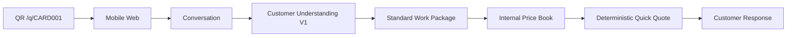
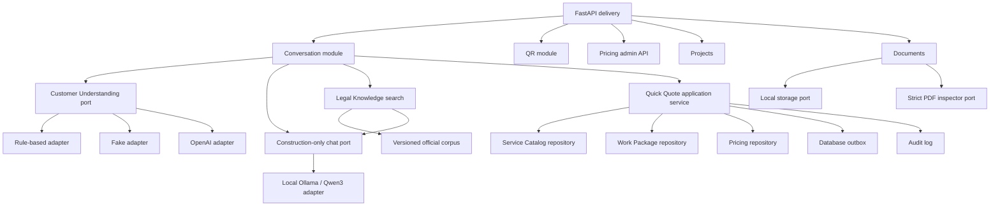
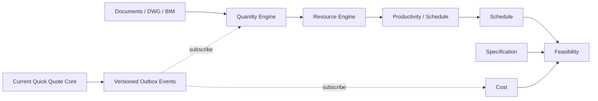

# Architecture Overview

GÜRSAR AI V1 is a modular monolith. Each module owns its domain, application behavior,
persistence adapter, and API surface. Cross-module work happens through application contracts,
repository ports, and outbox events rather than table access.

## QR to Quote

The understanding provider returns facts only. `QuickQuoteService` selects the active service and
work package, resolves the price through the location hierarchy, and performs arithmetic with
`Decimal`. Every selected price version is stored with the quote.

## Module Architecture

The domain layer imports neither FastAPI, SQLAlchemy, nor any AI SDK. ORM rows and Pydantic API
schemas are separate from domain dataclasses.

The local construction-chat adapter receives recent conversation messages and authoritative
quick-quote facts. It may explain construction topics and phrase the response naturally, but it
cannot replace price-book arithmetic. Structured scope classification turns out-of-domain requests
into a fixed construction-only refusal.

For legal or specification questions, `QuickQuoteService` retrieves the highest-scoring passages
from the legal corpus and labels them `K1`, `K2`, and `K3`. Ollama receives those passages as a
closed reference context: it may cite them but may not invent a law, article, TSE clause, or permit
decision. The customer response includes a de-duplicated official-source appendix.

## Data Ownership

| Module | Owned records |
| --- | --- |
| Conversation | `conversations`, `messages`, `customer_jobs` |
| Customer understanding | `analysis_snapshots` |
| Service catalog | `service_catalog` |
| Work package | `work_packages`, `work_package_items` |
| Pricing | `price_book` |
| Legal knowledge | `legal_documents`, `legal_chunks` |
| Quick quote | `quick_quotes` |
| QR | `qr_sources` |
| Core infrastructure | `audit_events`, `outbox_events` |
| Projects | `projects` |
| Documents | `documents`, `document_versions`, `sheets` |

Messages and snapshots are append-only. Price changes create new rows. Customer jobs are current
working projections whose changes are reconstructable from immutable messages and snapshots.

## Future Extension

Future engines subscribe to versioned events. They do not change customer intake, work-package,
or price-book contracts.
